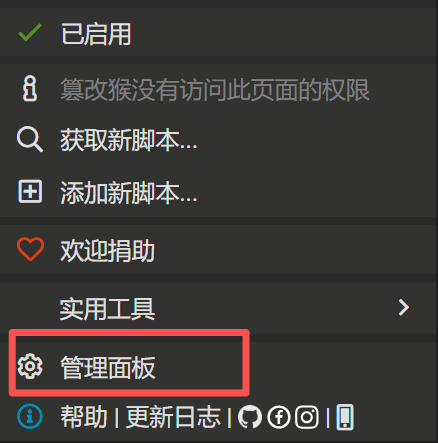
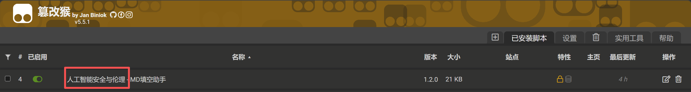
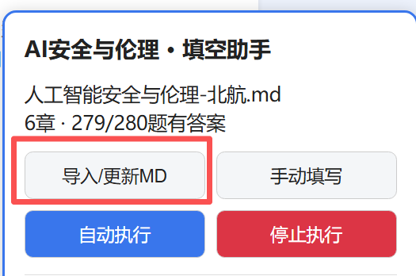

# 人工智能安全与伦理-北航雨课堂自动答题脚本

## 可自动化范围：
支持填空题

**不支持**：第二章最后两道主观题，第四章、第五章、第六章选择题

## 操作说明
1. git clone https://github.com/SeaCloudw/AI-Security-and-Ethics-BUAA-yuketang.git  或者直接下载js和md文件
2. 浏览器下载篡改猴插件，点击“管理面板”

3. 脚本拖入篡改猴

4. 登录雨课堂答题界面 (https://buaa.yuketang.cn/)
5. 点击"导入md" ，选择仓库中的“人工智能安全与伦理-北航.md”

6. 建议点击“手动填写”先测试几道题目，(“手动填写”自动填入答案，但是需要手动提交)，然后可以尝试“自动答题”
## 感谢
感谢 LazzyXP 的详尽笔记(https://github.com/LazzyXP/AI-Security-and-Ethics-BeiHang-University/tree/main)!

赞美伟大的互联网精神！
